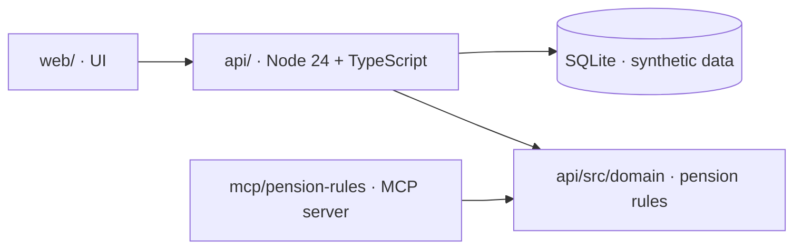

# 🧭 GitHub Copilot Advanced Workshop — Agentic Engineering in Practice

**Build, govern and automate an AI-assisted engineering platform** on a realistic (fictional) pension application.


> **Track:** Advanced (L300–L400) · **Format:** short talk ➜ hands-on lab, five times · **Environment:** GitHub Codespaces or the dev container
> **App:** *Contoso Pension Platform* — a fictional pension fund. **Synthetic data only. Simplified, not real pension rules.**

---

## ✅ Start here (10 minutes, before session A1)

| Step | Do this | You should see |
|---|---|---|
| 1 | Click **Use this template → Create a new repository**. Owner: your account (or the org your coach tells you). Visibility: **Private**. | Your own copy of this repo |
| 2 | In **your** repo: **Code → Codespaces → Create codespace on main** | A browser VS Code that builds for ~2 min |
| 3 | Open it in **VS Code Desktop**: bottom-left **Codespaces** menu → **Open in VS Code Desktop** *(recommended — every agent feature works there)* | VS Code Desktop connected to the Codespace |
| 4 | In the terminal: `npm run verify` | `✅ Ready for the workshop` |
| 5 | Go to **[Lab 00 · Setup](labs/00-setup/README.md)** | — |

> 🆘 Something fails? Raise your hand — coaches walk around. Plan B is in [Lab 00 · Troubleshooting](labs/00-setup/README.md#-troubleshooting).

---

## 🗺️ Agenda and labs

**[Explore the Copilot Lab Campus](https://tanure.github.io/contoso-copilot-advanced/)** for the interactive version. Meet the team in the welcome scene, then pick a room and advance the conversation one speaker at a time. When it’s your turn, complete the tasks in your own workshop repository; step instructions and available screenshots open without leaving the scene. Checkmarks stay in your browser. The Markdown guides below include all templates, troubleshooting, and stretch goals.

| # | Session | Level | Lab (do in this order) | You will build |
|---|---|---|---|---|
| 00 | Setup | — | [Lab 00 · Setup & orientation](labs/00-setup/README.md) | Running app, first Copilot chat, the 4 chat controls |
| A1 | Models, Enterprise Configuration & Engineering Controls | Intermediate | [Lab A1](labs/a1-models-enterprise-controls/README.md) | Model evaluation scorecard · guardrail hook · enterprise control map |
| A2 | Agent Architecture & Multi-Agent Systems | Advanced | [Lab A2](labs/a2-multi-agent-systems/README.md) | Planner / implementer / reviewer agents that ship *early retirement* |
| A3 | MCP & Tool Governance | Advanced | [Lab A3](labs/a3-mcp-tool-governance/README.md) | MS Learn MCP + your own MCP server, allow-lists, audit, prompt-injection defence |
| 🍽️ | Lunch | | | |
| A4 | Context Engineering | Advanced | [Lab A4](labs/a4-context-engineering/README.md) | Instructions, enterprise knowledge, an Agent Skill, memory — measured before/after |
| ☕ | Break | | | |
| A5 | Agentic CI/CD | Advanced | [Lab A5](labs/a5-agentic-cicd/README.md) | Cloud agent fixes a bug, Copilot code review, an agentic CI-doctor workflow |

📌 Keep the **[Cheat sheet](labs/CHEATSHEET.md)** open in a second tab — every UI path used today, verified for VS Code 1.146 (Nov 2026).

---

## 🏗️ The application in 30 seconds



```bash
npm start      # app on http://localhost:3000  (Codespaces opens the forwarded port)
npm test       # 30 tests, a few seconds, zero dependencies
```

More: [Architecture](docs/architecture.md) · [Business rules](docs/domain/scheme-rules.md) · [Service levels](docs/domain/service-levels.md) · [Glossary](docs/domain/glossary.md) · [ADRs](docs/adr) · [Backlog](docs/backlog)

---

## 🆘 Fell behind? Catch up in one command

Each lab starts from a known state. To jump to the **end state** of a lab:

```bash
git stash            # keep your own work (optional)
npm run catch-up -- a2
npm test
```

## 📏 Working agreements

1. **Synthetic data only.** Never paste real member data, company code, secrets or tokens into prompts, files or screenshots.
2. **You are the reviewer.** Read every diff and every tool call before approving. Agents propose — humans decide.
3. **Instructions are guidance, not controls.** Real controls are permissions, hooks, policies and CI.
4. **Observe, don't assume.** Expand tool calls, open the debug logs, check the References. A plausible answer is not proof.

## 📂 Repository map

```
api/            Node 24 TypeScript API (domain · repositories · services · routes) + tests
web/            Static UI (no build step)
campus/         GitHub Pages workshop guide (separate from the pension app)
mcp/            pension-rules MCP server (hand-written stdio JSON-RPC) + tests
data/seed/      Synthetic members, employers, contributions, service requests
docs/           Architecture, business rules, ADRs, backlog, images
labs/           00 + A1…A5 step-by-step labs, cheat sheet
solutions/      End state of each lab (used by npm run catch-up)
scripts/        verify-env, catch-up, post-create, create-backlog-issues, audit-report (npm run audit), check-public-safety
infra/          Optional Azure Container Apps Bicep (not deployed in the workshop)
.github/        CI, Copilot setup steps, templates (you add agents, skills, hooks, instructions)
```

---

### Preview or publish the campus

From the repository root, build and serve the same static files used by Pages:

```sh
npm ci --prefix scripts/campus --ignore-scripts
node scripts/campus/build.mjs .campus-preview
python -m http.server 8765 --bind 127.0.0.1 --directory .campus-preview
```

Open <http://127.0.0.1:8765/>. No pension API is needed. Edit conversations and checkpoints in `campus/stories.js`; the workbench instructions come from `labs/*/README.md`. After editing those files, rerun the build. If you rename or reorder lab steps, update `campus/guide-links.js` and run `node --test scripts/test-lab-campus.mjs`.

The final unchecked step opens the graduation scene. After that, the crew recap and downloadable GitHub Copilot Advanced Workshop completion badge are available from the campus progress panel in the same browser.

To publish, set **Settings → Pages → Build and deployment → Source** to **GitHub Actions**. The **Publish Lab Campus** workflow builds the site from `campus/`, the lab guides, and the reference images in `docs/images/`. You can also run the workflow manually on `main` after enabling Pages.

<sub>Fictional scenario and synthetic data. Contoso is a fictional company; not affiliated with any real pension fund or its systems. Scheme parameters are illustrative only.</sub>
