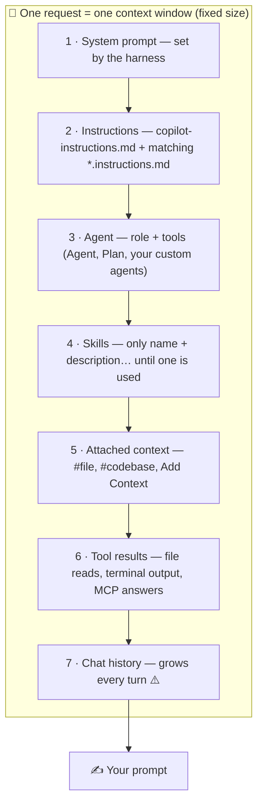
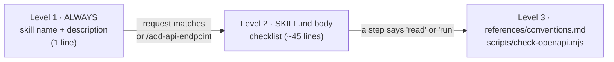
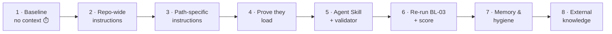

# Lab A4 · Context Engineering

> ⏱️ **45 min core + 10 min stretch** (after a 15-min talk) · 🎯 Advanced · 🧩 Builds on: [Lab A3](../a3-mcp-tool-governance/README.md) · 🆘 Behind? `npm run catch-up -- a3`

## 🎯 Goal

By the end of this lab you have:

- ✅ A **measured before/after**: the same backlog item (BL-03) scored on 8 conventions — without and with context
- ✅ **Repo-wide + path-specific instructions** that link to the ADRs instead of copying them, and proof that they load
- ✅ An **Agent Skill** `/add-api-endpoint` with a reference page and a **deterministic validator script**
- ✅ Habits for **context hygiene**: `/compact`, one task per chat, subagents for research, memory you can inspect

---

## 🧠 Concepts in 5 minutes

### 1 · The context window is a budget

Every request the agent sends is one "package" with a fixed size. Everything below competes for the same space.

| What | Why | Analogy | Example in Contoso |
|---|---|---|---|
| The text the model sees for **one** request: rules, files, tool output, history | Too little → it guesses. Too much → it gets distracted (and costs more AI credits) | A **suitcase** with a weight limit: pack what this trip needs | BL-03 needs `service-levels.md` + ADR-0002/0003 — not the Bicep file |



> 🎯 **Golden rule: right information · right time · right size.** Always-true rules → instructions. Task-specific know-how → skill. Live facts → tools/MCP.

### 2 · Progressive disclosure — link, don't paste

| What | Why | Analogy | Example in Contoso |
|---|---|---|---|
| Load detail **only when needed**: a short pointer first, the full text later | Keeps every request small; one source of truth (the ADR) instead of copies that go stale | A **table of contents**: you don't photocopy the whole book for every question | `copilot-instructions.md` says *"Errors — ADR-0002"* and links it; it doesn't paste the ADR |



> ⚠️ A Markdown link does **not** guarantee the linked text reaches the model. Write *when* to read it: "Before changing a rule, read `docs/domain/…`".

### 3 · Five ways to give an agent knowledge

**Analogy for the whole table:** you onboard a new colleague on your team.


| Tool | What | Why | Analogy (new colleague) | Example in Contoso |
|---|---|---|---|---|
| **Instructions** | Always-on rules (`.github/copilot-instructions.md`, `*.instructions.md` with `applyTo`) | Same conventions in every request | 🪧 The **house-rules poster** in the team room | "Errors only via `badRequest()`" |
| **Skill** | On-demand workflow + references + scripts (`.github/skills/<name>/SKILL.md`) | Detailed know-how without a permanent cost | 🗂️ A **recipe card** taken from the drawer when you cook that dish | `/add-api-endpoint` |
| **Custom agent** | A role with its own tools/model (`.github/agents/*.agent.md`) | Separate persona and permissions | 🪪 A **job description** | *Implementer* from A2 |
| **MCP retrieval** | Live tools/data outside the repo | Fresh, authoritative answers | 📞 The **colleague you call** | Microsoft Learn MCP, `pension-rules` (A3) |
| **Memory** | Facts Copilot learned while working (repository + user scope) | No maintenance, but Copilot decides what to use | 📓 Your own **notebook** | "Tests use a fixed clock 2026-11-18" |

### 4 · Context rot

| What | Why | Analogy | Example in Contoso |
|---|---|---|---|
| Answer quality drops as a long chat fills up with old turns, failed attempts and big tool outputs | The model weighs everything in the window — stale bits distract it | A **whiteboard** nobody wipes: new notes get lost in old ones | After 40 turns on the statement bug you ask for BL-03 → it reuses wrong assumptions |

| Symptom | Fix |
|---|---|
| Long chat, same task | `/compact` (summarises the conversation) |
| New, unrelated task | **New Chat (+)** — one task per chat |
| Big research that you only need the conclusion of | Ask for a **subagent** — only its summary comes back |

---

## 🗺️ Lab map



---

## Step 1 — Run the baseline experiment (⏱️ 10 min)

**Why:** you can only prove that context helps if you measure the agent **without** it first.

> 🎲 **Energiser:** before you start, write down your guess — how many of the 8 conventions will the agent get right without help?

1. Start from a clean tree. Commit what you have from earlier labs:
   ```bash
   git add -A && git commit -m "chore: end of A3"   # "nothing to commit" is fine
   git status --short                               # → no output
   ```
2. Check that there are **no** instruction or skill files yet:
   ```bash
   ls .github/copilot-instructions.md AGENTS.md .github/instructions .github/skills 2>/dev/null
   ```
   > 👀 **Expected:** no output. ⚠️ **If not:** you made one earlier — rename it (e.g. `mv AGENTS.md AGENTS.md.off`) and rename it back after Step 1.
3. Create the scorecard on `main` (so it survives the throwaway branch):
   ```bash
   mkdir -p docs/evaluations
   ```

**`docs/evaluations/context-scorecard.md`**
```markdown
# Context scorecard — BL-03 overdue service requests

> Score 1 = convention met, 0 = not met. Check with the command, not by eye.

| # | Convention (source) | How to check | Baseline | With context |
|---|---|---|:---:|:---:|
| 1 | Errors via `badRequest` / `notFound` / `unprocessable` ([ADR-0002](../../docs/adr/0002-error-envelope.md)) | `grep -nE "res\.end\|statusCode\|error:" api/src/routes/serviceRequests.ts` → no output | | |
| 2 | Static `/overdue` registered **before** `/:id` ([ADR-0003](../../docs/adr/0003-layered-architecture.md) rule 3) | `grep -n "router.get('/api/service-requests" api/src/routes/serviceRequests.ts` → `/overdue` line number is lower | | |
| 3 | SLA days 5 / 10 / 14 / 30 from [service-levels.md](../../docs/domain/service-levels.md) | `grep -rnE "address-change\|value-transfer\|retirement-quote\|complaint" api/src/domain` → the four values | | |
| 4 | Business rule in `api/src/domain/`, not in the route (ADR-0003 rule 1) | `git status --short api/src/domain` → a new file; the route only imports it | | |
| 5 | Tests use `startTestServer()` + fixed clock (ADR-0003 rule 4) | `grep -c "startTestServer" api/test/<new-file>.test.ts` ≥ 1 and `grep -c "new Date()" …` = 0 | | |
| 6 | `api/openapi.yaml` updated (ADR-0003 rule 2) | `grep -n "overdue" api/openapi.yaml` → a path entry | | |
| 7 | Erasable TS only: `.ts` imports, `import type`, no `enum` ([ADR-0001](../../docs/adr/0001-zero-dependency-runtime.md)) | `grep -rnwE "enum\|namespace" api/src api/test` → no output | | |
| 8 | `npm test` green | `npm test` → `fail 0` | | |
| | **Total** | | **_ / 8** | **_ / 8** |

## Observations

| Run | Time to "done" | What happened (1–2 lines) |
|---|---|---|
| Baseline | | |
| With context | | |
```

4. Commit it and create the throwaway branch:
   ```bash
   git add docs/evaluations && git commit -m "docs: A4 scorecard template"
   git switch -c a4-baseline
   ```
5. Open the Chat view (`Ctrl+Alt+I`) → **New Chat (+)**. Set **Harness** → **Copilot** · **Agent mode** → **Interactive** · **Model** → **Auto** · **Permissions** → **Manual permissions**.
6. Start a **5-minute timer** (phone or watch). Paste this prompt — deliberately short, no conventions mentioned:
   ```text
   Implement BL-03 (docs/backlog/BL-03-overdue-service-requests.md).
   Do not commit.
   ```
7. Approve tool calls as they come. For repeated `npm test` calls you may pick **Allow in this Session**.
8. When the timer rings, stop the request (look for the stop control in the chat input) — finished or not.
9. Score the **Baseline** column: run each *How to check* command from the scorecard and write `1` or `0`.
   ```bash
   git status --short     # which files did the agent touch?
   npm test               # convention 8
   ```

> 👀 **Expected:** a working-ish endpoint with **some** conventions missed. Typical misses: SLA table inside the route, `/overdue` registered after `/:id`, no OpenAPI entry.
> ⚠️ **If not:** a perfect 8/8 is possible — models improve. Keep the score; Step 6 then shows that context makes it *repeatable*, not luck.

> ⏩ **Short on time or a slow model? Plan-only fallback:** in step 5 pick **Agent mode** → **Plan** instead. Score conventions 1–7 on the plan ("does the plan say …?"), mark 8 as `n/a`.

10. Keep the score, throw away the code:
    ```bash
    git add -A && git commit -qm "a4: baseline attempt (throwaway)"
    git switch main
    git checkout a4-baseline -- docs/evaluations/context-scorecard.md   # bring the scores along
    git branch -D a4-baseline
    git status --short     # → M  docs/evaluations/context-scorecard.md
    ```

> 💡 **Prefer not to commit the attempt?** `git stash -u` parks *all* changes incl. new files (`git stash drop` later). `git checkout .` only reverts **tracked** files — new files the agent created stay behind. Either way: copy your scores first.

<!-- 📸 SCREENSHOT: a4-01-baseline.png — Chat with Copilot/Agent/Auto/Manual and the BL-03 prompt, tool calls expanded -->

### ✅ Checkpoint 1

- [ ] `git branch --list a4-baseline` → no output (branch deleted)
- [ ] Baseline column filled: `awk -F'|' '/^\| [1-8] \|/ && $(NF-2) ~ /[01]/' docs/evaluations/context-scorecard.md | wc -l` → `8` (Plan-only: `7`)
- [ ] `ls api/src/domain` → only `pension.ts` and `scheme.ts` (baseline code is gone)

---

## Step 2 — Write the repo-wide instructions (⏱️ 5 min)

**Why:** the rules the baseline missed are true for **every** request — they belong on the house-rules poster.

1. Command Palette (`Ctrl+Shift+P`) → **Chat: Open Customizations** → **Instructions** → **+** next to **Workspace** → choose `.github/copilot-instructions.md` if offered.
   *Faster:* create the file directly in the Explorer.
2. Paste the content below and save.

**`.github/copilot-instructions.md`**
```markdown
# Contoso Pension Platform — instructions for Copilot

Fictional pension member-services app (workshop). **Synthetic data only**: never add real names, BSNs, secrets or tokens to code, tests, prompts or logs.

## Stack — [ADR-0001](../docs/adr/0001-zero-dependency-runtime.md)
- Node.js 24 runs TypeScript natively: no build step, **no npm dependencies** (a new dependency needs a new ADR).
- Use `node:http`, `node:sqlite` (in-memory, seeded from `data/seed/`) and `node:test`.
- Erasable TypeScript only: no `enum`, no `namespace`, no constructor parameter properties.
- Relative imports end in `.ts`; type-only imports use `import type`.

## Architecture — [ADR-0003](../docs/adr/0003-layered-architecture.md)
- `api/src/routes/` HTTP only → `api/src/services/` use-cases → `api/src/repositories/` SQL only + `api/src/domain/` pure rules (no I/O).
- Business rules live **only** in `api/src/domain/`. Take rule values (ages, rates, SLA days) from `docs/domain/*.md`; never invent them.
- Every new endpoint = route + test in `api/test/` + path in `api/openapi.yaml`.
- Static paths (e.g. `/overdue`) are registered **before** `/:id` paths — the router matches in registration order.

## Errors — [ADR-0002](../docs/adr/0002-error-envelope.md)
- Throw `badRequest()` (400), `notFound()` (404) or `unprocessable()` (422) from `api/src/http/errors.ts`.
- Never `res.end('…')` or ad-hoc error JSON.

## Read before you change
| If the task touches… | Read first |
|---|---|
| a business rule or calculation | [scheme rules](../docs/domain/scheme-rules.md), [service levels](../docs/domain/service-levels.md), [glossary](../docs/domain/glossary.md) |
| a backlog item | the `docs/backlog/BL-*.md` file — acceptance criteria are the definition of done |
| the overall design | [architecture](../docs/architecture.md) |

## Commands
- `npm test` — all tests, must stay green · `npm run test:api` — API tests only · `npm start` — app on port 3000.
- Tests use the fixed clock `2026-11-18` (`startTestServer()` in `api/test/helpers.ts`).

## Definition of done
- `npm test` passes, and your summary lists the docs and ADRs you followed.
- Do not change `data/seed/` or existing tests to make new code pass.
```

3. Check the size (short = cheap and focused):
   ```bash
   wc -l .github/copilot-instructions.md     # → 40 or less
   ```

| Section | Why it is there |
|---|---|
| Synthetic data line | A guardrail **reminder** — the real control is hooks + policy (A1) |
| Stack / Architecture / Errors | Exactly the conventions from the scorecard, each with a **link** to the ADR |
| Read before you change | Progressive disclosure: *when* to open which doc |
| Commands + Definition of done | The agent verifies itself the same way you do |

> 💡 Write rules the agent **can act on** ("throw `badRequest()`") — not wishes ("write good code").

---

## Step 3 — Add path-specific instructions (⏱️ 4 min)

**Why:** route rules and test rules only matter when the agent touches those files — so they load only then.

1. **Chat: Open Customizations** → **Instructions** → **+** next to **Workspace** → new instructions file → folder `.github/instructions` → name `api-routes`. *Or* create the files directly.
2. Paste and save:

**`.github/instructions/api-routes.instructions.md`**
```markdown
---
applyTo: 'api/src/routes/**/*.ts'
---
# API routes (ADR-0002 · ADR-0003)

- A route does HTTP only: read `params` / `query` / `body`, validate, call a repository, service or domain function, return `{ body }` or `{ status, body }`.
- No business rules or rule values in a route. Put calculations in a pure function in `api/src/domain/` and import it.
- Validate first. Collect problems in a `string[]` and `throw badRequest('<summary>', problems)`.
- ISO date parameters: check `/^\d{4}-\d{2}-\d{2}$/` and throw `badRequest('<name> must be an ISO date (YYYY-MM-DD)')`.
- Unknown id → `throw notFound(\`Member ${id}\`)`. A domain `RangeError` → catch it and `throw unprocessable(err.message)`.
- "Today" comes from the injected `deps.today()` clock — never `new Date()` inside a route (tests use a fixed clock).
- Register static paths such as `/api/service-requests/overdue` **before** `/api/service-requests/:id`.
- Imports: `import type` for types, `.ts` extension on every relative import.
- In the same change: add the path to `api/openapi.yaml` and a test in `api/test/`.
- Pattern to copy: `GET /api/members/:id/statement` in `api/src/routes/members.ts` (optional `asOf` with default `deps.today()`).
```

3. Repeat for the tests file:

**`.github/instructions/tests.instructions.md`**
```markdown
---
applyTo: 'api/test/**/*.ts'
---
# API tests (ADR-0001 · ADR-0003 rule 4)

- Only `node:test` and `node:assert/strict`. No test libraries, no mocking frameworks.
- API tests: `api = await startTestServer()` from `./helpers.ts` in `before`, `await api.close()` in `after`.
- The clock is fixed at `2026-11-18`. Need another day? Pass it: `startTestServer('2026-10-16')`. Never depend on the real date.
- Pure domain functions get plain unit tests (no server), including the edge cases written in `docs/domain/*.md`.
- Assert exact values from the backlog acceptance criteria (ids, numbers, order) — not just "length > 0".
- Error cases: assert `res.status` and `(await res.json()).error.code` (e.g. `BAD_REQUEST`).
- One file per feature: `api/test/<feature>.test.ts`. Do not edit existing tests to make new code pass.
- `data/seed/` is shared, read-only test data. Never change it for a test.
- Run `npm run test:api` while iterating, then `npm test` before you finish.
```

| Frontmatter | Meaning |
|---|---|
| `applyTo: 'api/src/routes/**/*.ts'` | Glob **relative to the repo root** (not to `.github/instructions`) |
| File name ends in `.instructions.md` | Required — otherwise it is just a Markdown file |

> 🚦 **Analogy:** the poster (Step 2) hangs in the whole office; these are the signs on the lab door — you only read them when you walk in.

---

## Step 4 — Prove the instructions load (⏱️ 3 min)

**Why:** observe, don't assume — a file that isn't loaded has zero effect.

1. **Chat: Open Customizations** → **Instructions**: your 3 files are listed (this proves *discovery*).
2. **New Chat (+)** → **Copilot · Interactive · Manual permissions**.
3. Paste:
   ```text
   Open api/src/routes/serviceRequests.ts and api/test/api.test.ts.
   In 5 bullets: which rules must a new route and its test follow in this repository?
   After each bullet, name the instruction file it comes from.
   Do not change any files.
   ```
4. Expand the response's **References**.
5. For more detail: open **Agent Debug Logs** (or type `/debug`) and look for the customization-discovery events.

> 👀 **Expected:** References list `copilot-instructions.md`, `api-routes.instructions.md` **and** `tests.instructions.md`; the bullets mention route order, error helpers and `startTestServer()`.
> ⚠️ **If not:** (1) start a **new** chat — old chats keep their old context; (2) check the `applyTo` glob and the quotes; (3) the file name must end in `.instructions.md`.

<!-- 📸 SCREENSHOT: a4-04-references.png — Response with References expanded showing the 3 instruction files -->

### ✅ Checkpoint 2

- [ ] `ls .github/copilot-instructions.md .github/instructions/*.instructions.md` → 3 files
- [ ] `head -2 .github/instructions/tests.instructions.md` → `---` and `applyTo: 'api/test/**/*.ts'`
- [ ] **References** of your Step 4 answer show all 3 instruction files

---

## Step 5 — Package the workflow as an Agent Skill (⏱️ 8 min)

**Why:** "how to add an endpoint here" is a multi-step recipe with a check — too big for always-on instructions, perfect for a skill.

| Skill rule | In this skill |
|---|---|
| Folder name **==** `name:` (lowercase-hyphen, ≤ 64 chars) | `.github/skills/add-api-endpoint/` ↔ `name: add-api-endpoint` |
| `description:` says **what + when** — it decides auto-loading | "…Use when implementing a backlog item…" |
| Extra files next to `SKILL.md`, linked with relative paths | `references/conventions.md`, `scripts/check-openapi.mjs` |
| Invoke | `/add-api-endpoint …` or automatically when a request matches |

1. Create the folders (or **Chat: Open Customizations** → **Skills** and look for **+** next to **Workspace**):
   ```bash
   mkdir -p .github/skills/add-api-endpoint/references .github/skills/add-api-endpoint/scripts
   ```
2. Create the skill:

**`.github/skills/add-api-endpoint/SKILL.md`**
````markdown
---
name: add-api-endpoint
description: Add or change a REST endpoint in the Contoso API end-to-end (domain rule, route, tests, OpenAPI) following ADR-0001..0003, and prove it with a deterministic check. Use when implementing a backlog item from docs/backlog/BL-*.md or any request that adds or changes an /api/... path.
argument-hint: '[backlog file or endpoint description]'
---
# Add an API endpoint

Work through the steps **in order**. Show this checklist in your reply and tick each item.

## 1. Understand — read, don't guess
- [ ] Read the backlog item or request. Quote its acceptance criteria.
- [ ] Read every business-rule doc it links (`docs/domain/*.md`). Copy rule values from there, never from memory.
- [ ] Read [the endpoint conventions](./references/conventions.md) (one page).
- [ ] Open one similar existing route as a pattern: `GET /api/members/:id/statement` in `api/src/routes/members.ts`.

## 2. Plan — stop if unclear
- [ ] List the files you will create or change, per layer (domain → route → OpenAPI → tests).
- [ ] If the acceptance criteria conflict with a doc, STOP and ask the user.

## 3. Implement — layer by layer
- [ ] **Domain**: pure functions and rule values in `api/src/domain/<topic>.ts`. Add a comment linking the doc.
- [ ] **Route**: in the existing `api/src/routes/<resource>.ts`. Validate → call domain/repository → return `{ body }`. Errors only via `badRequest` / `notFound` / `unprocessable`. Static paths **before** `/:id`.
- [ ] **OpenAPI**: add the path, its query parameters, the 200 schema and error responses (`$ref: '#/components/responses/BadRequest'`) to `api/openapi.yaml`.
- [ ] **Tests**: `api/test/<feature>.test.ts` — unit tests for the domain function (edge cases from the doc) and API tests with `startTestServer()` that assert the exact acceptance-criteria values and the 400 envelope.

## 4. Verify — deterministic, never skip
Run both from the repository root:

```bash
node .github/skills/add-api-endpoint/scripts/check-openapi.mjs
npm test
```

- [ ] [check-openapi.mjs](./scripts/check-openapi.mjs) exits 0: every registered route is in `api/openapi.yaml` and no static route is shadowed by `/:id`.
- [ ] `npm test` shows `fail 0`.
- [ ] If a check fails: fix the reported problem and run **both** checks again.

## 5. Report
- A table: acceptance criterion → test name that proves it.
- Files changed, grouped per layer.
- The docs and ADRs you followed (links).

## Do not
- Add npm dependencies, change `data/seed/`, or edit existing tests to make them pass.
- Put rule logic or rule values in a route.
- Claim success without the output of both checks.
````

3. Create the reference page (level 3 — read only when the checklist says so):

**`.github/skills/add-api-endpoint/references/conventions.md`**
````markdown
# Endpoint conventions (one page)

Loaded only when the `add-api-endpoint` skill needs it. The source of truth stays in the ADRs — this page is the checklist view.

| # | Rule | Source | Good example |
|---|---|---|---|
| 1 | Errors use the envelope helpers `badRequest` (400) · `notFound` (404) · `unprocessable` (422) | [ADR-0002](../../../../docs/adr/0002-error-envelope.md) | `throw badRequest('asOf must be an ISO date (YYYY-MM-DD)')` |
| 2 | Static paths are registered before `/:id` paths | [ADR-0003](../../../../docs/adr/0003-layered-architecture.md) rule 3 | `/api/service-requests/overdue` above `/api/service-requests/:id` |
| 3 | Rule values come from the domain docs, not memory | [docs/domain](../../../../docs/domain/) | SLA days from [service-levels.md](../../../../docs/domain/service-levels.md) |
| 4 | Business rules live in `api/src/domain/` (pure, no I/O) | ADR-0003 rule 1 | `dueDate(request)` in `api/src/domain/<topic>.ts`, called by the route |
| 5 | Tests use `startTestServer()` with the fixed clock `2026-11-18` | ADR-0003 rule 4 | `startTestServer('2026-10-16')` for another day |
| 6 | Every endpoint is in `api/openapi.yaml` | ADR-0003 rule 2 | checked by `scripts/check-openapi.mjs` |
| 7 | Erasable TypeScript: `.ts` imports, `import type`, no `enum` / `namespace` | [ADR-0001](../../../../docs/adr/0001-zero-dependency-runtime.md) | `import type { Router } from '../http/router.ts';` |
| 8 | `npm test` is green | — | `fail 0` |

## Shape of a "list with a computed field" endpoint

```ts
// api/src/routes/<resource>.ts  — HTTP only
router.get('/api/<resource>/<static-path>', ({ query }) => {
  const asOf = query.get('asOf') ?? deps.today();
  if (!/^\d{4}-\d{2}-\d{2}$/.test(asOf)) throw badRequest('asOf must be an ISO date (YYYY-MM-DD)');
  const items = deps.<repository>.list().map((item) => ({ ...item, <computed>: <domainFunction>(item, asOf) }));
  return { body: items };
});
```

## Common mistakes the agent makes without this skill
- Puts the SLA table inside the route file → rule 4 broken.
- Registers `/overdue` after `/:id` → the endpoint returns `404 Service request overdue not found`.
- Uses `new Date()` → tests depend on the real date.
- Forgets `api/openapi.yaml` → `check-openapi.mjs` exits 1.
````

4. Create the validator (zero dependencies, reads the YAML as text — ADR-0001):

**`.github/skills/add-api-endpoint/scripts/check-openapi.mjs`**
```js
#!/usr/bin/env node
// Deterministic check for the add-api-endpoint skill (ADR-0003 rules 2 + 3).
//   1. Every route registered in api/src/routes/*.ts has a matching path + method in api/openapi.yaml.
//   2. No static route is registered AFTER a parameter route that would swallow it (e.g. /overdue after /:id).
// Zero dependencies (ADR-0001): reads the YAML as plain text. Exit 0 = OK, exit 1 = problems found.
// Usage (from the repo root): node .github/skills/add-api-endpoint/scripts/check-openapi.mjs
import { readFileSync, readdirSync } from 'node:fs';
import { join } from 'node:path';

const root = process.argv[2] ?? process.cwd();
const routesDir = join(root, 'api/src/routes');
const openapiFile = join(root, 'api/openapi.yaml');

// --- 1. Documented operations: "GET /api/members/{id}" -------------------------------
const documented = new Set();
let inPaths = false;
let currentPath = null;
for (const line of readFileSync(openapiFile, 'utf8').split('\n')) {
  if (/^paths:\s*$/.test(line)) { inPaths = true; continue; }
  if (inPaths && /^\S/.test(line)) break; // next top-level key (components:) ends the paths block
  const pathMatch = inPaths && line.match(/^ {2}(\/\S*):\s*$/);
  if (pathMatch) { currentPath = pathMatch[1]; continue; }
  const methodMatch = inPaths && currentPath && line.match(/^ {4}(get|post|put|patch|delete):/);
  if (methodMatch) documented.add(`${methodMatch[1].toUpperCase()} ${currentPath}`);
}

// --- 2. Registered routes, in registration order per file ---------------------------
const ROUTE = /router\.(get|post|put|patch|delete)\(\s*(['"`])([^'"`]+)\2/g;
const toOpenApi = (path) => path.replace(/:([A-Za-z]+)/g, '{$1}');
const toRegex = (path) => new RegExp('^' + path.replace(/:([A-Za-z]+)/g, '[^/]+') + '/?$');

const problems = [];
let routeCount = 0;
for (const file of readdirSync(routesDir).filter((f) => f.endsWith('.ts')).sort()) {
  const source = readFileSync(join(routesDir, file), 'utf8');
  const seen = [];
  for (const [, method, , path] of source.matchAll(ROUTE)) {
    routeCount++;
    const op = `${method.toUpperCase()} ${toOpenApi(path)}`;
    if (!documented.has(op)) problems.push(`❌ ${file}: ${op} is missing in api/openapi.yaml`);
    const shadow = seen.find((earlier) => earlier.method === method && earlier.path.includes(':') && toRegex(earlier.path).test(path));
    if (shadow) problems.push(`❌ ${file}: ${method.toUpperCase()} ${path} is registered after ${shadow.path} and will never match (ADR-0003 rule 3)`);
    seen.push({ method, path });
  }
}

if (problems.length) {
  console.error(problems.join('\n'));
  console.error(`\n${problems.length} problem(s) in ${routeCount} routes. Fix them, then run this check again.`);
  process.exit(1);
}
console.log(`✅ ${routeCount} routes checked: all documented in api/openapi.yaml, no shadowed static routes.`);
```

5. Test the validator on the current repo:
   ```bash
   node .github/skills/add-api-endpoint/scripts/check-openapi.mjs; echo "exit=$?"
   ```
   > 👀 **Expected:** `✅ 11 routes checked: all documented in api/openapi.yaml, no shadowed static routes.` and `exit=0`
6. Prove it can **fail** (a check that never fails proves nothing):
   ```bash
   sed -i 's#  /api/employers/{id}:#  /api/employers-broken:#' api/openapi.yaml
   node .github/skills/add-api-endpoint/scripts/check-openapi.mjs; echo "exit=$?"
   git checkout api/openapi.yaml
   ```
   > 👀 **Expected:** `❌ employers.ts: GET /api/employers/{id} is missing in api/openapi.yaml` and `exit=1`. After `git checkout` the file is restored.
7. **New Chat (+)** → type `/` → `add-api-endpoint` appears in the list. Don't run it yet.
8. Commit the context files:
   ```bash
   git add .github docs/evaluations && git commit -m "feat(a4): instructions + add-api-endpoint skill"
   ```

> ⚠️ **Skill not in the `/` menu?** The `name:` must equal the folder name exactly; invalid characters make it fail **silently**. Start a new chat after fixing.
> 🆘 **Behind?** Copy just the context files (not the solution code): `cp -r solutions/a4/.github/. .github/`

<!-- 📸 SCREENSHOT: a4-05-skill-menu.png — Chat input with "/" typed showing add-api-endpoint -->

---

## Step 6 — Re-run BL-03 with context and score again (⏱️ 10 min)

**Why:** same task, same model, same prompt size — the only variable is the context you engineered.

1. Create the feature branch:
   ```bash
   git switch -c feature/bl-03-overdue
   ```
2. **New Chat (+)** → **Copilot** · **Agent** · **Auto** · **Manual** (same as the baseline).
3. Start the timer again and paste:
   ```text
   /add-api-endpoint Implement docs/backlog/BL-03-overdue-service-requests.md
   ```
4. Watch the tool calls. You should see it **read** `service-levels.md`, **run** `check-openapi.mjs` and `npm test`.
5. Verify deterministically — never trust "Done ✅" in chat:
   ```bash
   npm test                                                             # → fail 0
   node .github/skills/add-api-endpoint/scripts/check-openapi.mjs       # → ✅ 12 routes checked …
   ```
6. Start the app in a **second** terminal:
   ```bash
   npm start
   ```
7. In the first terminal, call the endpoint for the workshop day:
   ```bash
   curl -s "localhost:3000/api/service-requests/overdue?asOf=2026-11-18" | node -e "let s='';process.stdin.on('data',d=>s+=d).on('end',()=>console.log(JSON.parse(s).map(r=>r.id+'('+r.daysOverdue+')').join(' ')))"
   ```
   > 👀 **Expected (exact):** `SR-5004(34) SR-5001(19) SR-5003(11) SR-5006(3) SR-5005(2)`
8. Check the error envelope:
   ```bash
   curl -s "localhost:3000/api/service-requests/overdue?asOf=yesterday"
   ```
   > 👀 **Expected:** `{"error":{"code":"BAD_REQUEST","message":"…"}}` — the message wording may differ.
9. Stop the app (`Ctrl+C`). Fill the **With context** column of the scorecard with the same commands as in Step 1.
10. Commit:
    ```bash
    git add -A && git commit -m "feat: BL-03 overdue service requests"
    ```

> ⚠️ **curl shows `{"error":{"code":"NOT_FOUND","message":"Service request overdue not found"}}`?** `/overdue` was registered after `/:id` — `check-openapi.mjs` reports this too. Ask the agent to fix it in the same chat, then re-run steps 5–7.
> ⚠️ **Different numbers?** Compare with the reference: `git diff --no-index solutions/a4/api/src/domain/serviceLevels.ts api/src/domain/serviceLevels.ts`

<!-- 📸 SCREENSHOT: a4-06-with-context.png — Agent response with the criterion → test table and the check-openapi output -->

### ✅ Checkpoint 3

- [ ] `npm test` → `fail 0`
- [ ] `node .github/skills/add-api-endpoint/scripts/check-openapi.mjs` → `✅ 12 routes checked …` (exit 0)
- [ ] curl → `SR-5004(34) SR-5001(19) SR-5003(11) SR-5006(3) SR-5005(2)`
- [ ] With-context column filled: `awk -F'|' '/^\| [1-8] \|/ && $(NF-1) ~ /[01]/' docs/evaluations/context-scorecard.md | wc -l` → `8` — compare your totals with your energiser guess

| | Baseline | With context |
|---|---|---|
| What the agent knew | Only what it could discover in 5 min | House rules + recipe + a check it must pass |
| How you knew it was right | You searched for mistakes | A script and tests told you |

---

## Step 7 — Keep the context clean: memory & hygiene (⏱️ 3 min)

**Why:** good context decays — long chats rot, and memories can go stale.

1. In your Step 6 chat, type:
   ```text
   /compact
   ```
   > 👀 **Expected:** the conversation is summarised; you can continue with a smaller context.
2. **New Chat (+)** → **Copilot · Interactive · Manual permissions** → paste:
   ```text
   What do you remember about this repository and about me?
   Separate repository facts from user preferences. Do not store anything new.
   ```
   > 👀 **Expected:** a short list, **or** "nothing stored" — both are fine. Memory depends on your settings and your organisation's policy.
3. Open Settings and search for `chat.copilot.memory.enabled` — this is the VS Code switch for Copilot Memory.
4. Try a subagent for research (only the summary lands in *your* context):
   ```text
   Use a subagent to map the rules R1–R7 in docs/domain/scheme-rules.md to the functions in api/src/domain/pension.ts.
   Return only a 7-row table: rule → function → file:line. Do not change any files.
   ```
5. Title bar → **Open in Agents** → open the subagent's read-only chat to see what it read.

| Copilot Memory | Facts |
|---|---|
| **Repository** scope | Facts about this repo, shared with collaborators |
| **User** scope | Your personal preferences, follow you across repos (on Business/Enterprise only if the org policy allows it) |
| Expiry | Memories that are not reinforced are retired automatically. GitHub Docs: 90-day default, admins can tune the retention (see 📚). |
| Not a rule! | Copilot *judges* whether a memory still applies → must-follow rules go in **instructions** |

| Hygiene rule | Why |
|---|---|
| One task per chat | No context mixing |
| `/compact` in long chats | Keeps the summary, drops the noise |
| Subagent for research | Main context only gets the answer (⚠️ subagents use extra AI credits) |
| Hand over with a file, not a chat | A plan file in a new chat = clean start |

---

## Step 8 — Pull in external knowledge on demand (⏱️ 2 min)

**Why:** some knowledge isn't in the repo — fetch it *when needed* instead of pasting it into instructions.

| Source | Use it when | How |
|---|---|---|
| `#codebase` | "Where in this repo is …?" | Type `#codebase` in your prompt (remote index; command **Build Codebase Semantic Index**) |
| `#web/fetch` | One specific public web page | `#web/fetch https://nodejs.org/api/test.html` |
| **Microsoft Learn MCP** (A3, `microsoftLearn` in `.mcp.json`) | Microsoft / Azure documentation | "Use the microsoftLearn MCP server to …" — then **expand the tool call** |
| **Copilot Spaces** (optional, github.com) | Curated team knowledge (repos, docs, notes) shared with others | Reachable from the IDE via the GitHub MCP server |

1. Pick **one** and try it in a **New Chat (+)** with **Copilot · Interactive · Manual permissions**:
   ```text
   Using #web/fetch https://nodejs.org/api/test.html: in 3 bullets, how could our tests mock time instead of passing a fixed date to startTestServer()?
   Quote the section you used. Do not change any files.
   ```
2. Expand the tool call to confirm the page was really fetched.

> ⚠️ **Blocked by policy or no internet?** Use `#codebase` instead — it works on the repo index. Never paste internal company documents into a public tool.

---

## 🚀 Stretch goals

1. **AGENTS.md vs copilot-instructions.md** — both are *always added* in the Copilot harness. Decide when to use which:

   | Use `AGENTS.md` when… | Use `.github/copilot-instructions.md` when… |
   |---|---|
   | the repo is also used by other agents (cross-agent format) | the team uses GitHub Copilot only |

   💡 Hint: pick **one** per repo — two always-on files invite duplicates and conflicts.
2. **Inspect instruction sources from the CLI** — run `copilot instruction --help` and use what it lists to show which instruction files the CLI picks up in this repo. 💡 Hint: compare with **References** from Step 4.
3. **Give a custom agent the skill** — in `.github/agents/implementer.agent.md` (A2) add `skills: ['add-api-endpoint']` to the frontmatter. Ask the *Feature Lead* to implement BL-04 and check in the **Agents window** that the Implementer subagent loaded `SKILL.md`.
4. **Measure the cost** — open **Agent Debug Logs** for the baseline and the with-context chat. Count LLM requests and tool calls. 💡 Hint: more upfront context can mean *fewer* retries — and fewer AI credits overall.

> ⚠️ **Old tutorials** mention `.prompt.md` prompt files, `/create-skill`, `handoffs:` and a `description:` for task-based instruction loading — those belong to the deprecated **Local** harness. In the Copilot harness use **skills** and **subagents**.

---

## 🧾 Recap

| Concept | What you did | Where it lives in the repo |
|---|---|---|
| Measure first | Scored BL-03 without and with context | `docs/evaluations/context-scorecard.md` |
| Always-on rules | Short, linked house rules | `.github/copilot-instructions.md` |
| Scoped rules | Route + test rules via `applyTo` | `.github/instructions/*.instructions.md` |
| Progressive disclosure | Skill = description → checklist → reference/script | `.github/skills/add-api-endpoint/` |
| Deterministic verification | Validator + tests + curl | `scripts/check-openapi.mjs`, `npm test` |
| Context hygiene | `/compact`, new chat, subagent, memory check | your chat habits |

## 🏢 Bring it to your organisation

- **Central instruction templates per tech stack** (e.g. Java, .NET, front-end) in one template repo owned by a platform team or guild; product teams copy and *link* to their own ADRs. Risk: copies drift — version the templates and review them like code.
- **Knowledge ownership & freshness**: put `.github/instructions/`, `.github/skills/` and `docs/adr/` under `CODEOWNERS`, add a review date, and re-run a scorecard after every big change. Stale context is worse than none.
- **Organisation-level instructions** (🧑‍🏫 look & discuss): organisation-wide guidance can be centrally managed for supported experiences — keep it to universal rules (security, synthetic data, language). Instructions are guidance; enforce must-haves with hooks, policies and CI.

## 📚 Learn more

- [Set up a context engineering flow in VS Code](https://code.visualstudio.com/docs/agents/guides/context-engineering-guide)
- [Use custom instructions in VS Code](https://code.visualstudio.com/docs/agent-customization/custom-instructions)
- [Use Agent Skills in VS Code](https://code.visualstudio.com/docs/agent-customization/agent-skills)
- [About GitHub Copilot Memory](https://docs.github.com/en/copilot/concepts/prompting-and-context/copilot-memory)
- [About GitHub Copilot Spaces](https://docs.github.com/en/copilot/concepts/prompting-and-context/spaces)
- [Usage-based billing (AI credits)](https://docs.github.com/copilot/concepts/billing/usage-based-billing-for-organizations-and-enterprises)

➡️ **Next:** [Lab A5 · Agentic CI/CD](../a5-agentic-cicd/README.md)
